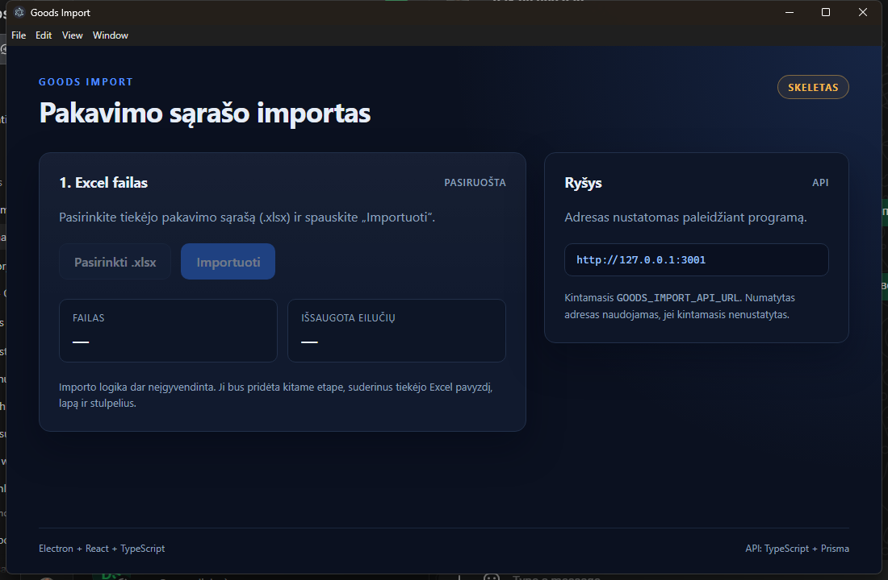

# goods-import

„Windows“ programa tiekėjo Excel pakavimo sąrašui importuoti. **Šiuo metu veikia Excel
failo pasirinkimas ir struktūros analizė:** darbo tvarka, Electron + React + TypeScript
klientas ir TypeScript API su Prisma schema. Importo logikos dar nėra.

**Būsena:** 005 — `DONE` (Excel failo pasirinkimas ir struktūros analizė, priimta
2026-11-25). Importo logika dar neįgyvendinta.



- **Užduočių registras:** [docs/tasks/README.md](docs/tasks/README.md)
- **Sprendimai:** [docs/decisions.md](docs/decisions.md)
- **Aplinkos sprendimai:** [docs/environment.md](docs/environment.md)
- **Agentų tvarka:** [AGENTS.md](AGENTS.md)

## Technologijos

| Sluoksnis | Technologijos                                                   |
| --------- | --------------------------------------------------------------- |
| Desktop   | Electron 44.11.5, React 18, TypeScript, electron-vite           |
| API       | TypeScript, Fastify 5, Prisma 6.19.3                            |
| DB        | PostgreSQL (schema paruošta; skeletas prie DB nesijungia)       |
| Repo      | npm workspaces monorepo, ES modulių šaltinis                     |

## Reikalavimai

- Node.js >= 20 (darbo aplinkoje naudojama Node.js 24)
- npm
- PostgreSQL — reikalingas tik vėlesniame importo etape

## Diegimas

Iš repo šaknies:

```powershell
npm.cmd install
```

> **Windows PowerShell:** `npm.ps1` gali būti blokuojamas pagal Execution Policy, todėl
> komandos rašomos kaip `npm.cmd`. `cmd.exe`, Linux ir macOS atveju `.cmd` nereikia —
> naudokite `npm`.

`npm install` paleidžia ir `scripts/ensure-electron.mjs`, kuris atsiunčia Electron 44
binary, jei jo dar nėra (šios Electron versijos pakete nėra `postinstall` skripto).
Jei npm praneša apie užblokuotus dependency install scriptus, juos galima peržiūrėti ir
patvirtinti:

```powershell
npm.cmd install-scripts ls
npm.cmd install-scripts approve --all
npm.cmd install
```

## Paleidimas

Reikia dviejų terminalų.

**1 terminalas — API:**

```powershell
npm.cmd run dev:api
```

API klausosi `http://127.0.0.1:3001`. Patikra:

```powershell
Invoke-RestMethod http://127.0.0.1:3001/health
```

Tikėtinas atsakymas:

```json
{"status":"ok","service":"goods-import-api"}
```

**2 terminalas — desktop:**

```powershell
npm.cmd run dev:desktop
```

Atsidaro Electron langas su „Excel importas“ ekranu. Mygtukai šiame etape neaktyvūs.

> Jei komanda paleidžiama DSH agento shell'e, pirmiausia pašalinkite
> `ELECTRON_RUN_AS_NODE` (žr. [docs/environment.md](docs/environment.md)). Įprastame
> Windows terminale šio kintamojo nėra.

### API adreso konfigūravimas

Klientas API adresą gauna iš kintamojo `GOODS_IMPORT_API_URL`; jei jis nenustatytas,
naudojama `http://127.0.0.1:3001`.

```powershell
$env:GOODS_IMPORT_API_URL = 'http://127.0.0.1:4000'
npm.cmd run dev:desktop
```

Adresas parodomas programos lange. API portą galima pakeisti per `PORT`:

```powershell
$env:PORT = '4000'
npm.cmd run dev:api
```

## Patikra

```powershell
npm.cmd run typecheck
npm.cmd run build
```

- `typecheck` — TypeScript patikra abiejuose paketuose.
- `build` — API sukompiliuojamas į `apps/api/dist`, desktop į `apps/desktop/out`.

GUI patikra: paleidus `npm.cmd run dev:desktop`, turi atsidaryti langas be konsolės
klaidų. Importo funkcionalumo patikra bus pridėta kartu su 2 etapu.

### Patikros rezultatas (2026-11-25)

- `npm.cmd install` → exit 0; įdiegti 178 paketai, Electron 44.11.5, Prisma 6.19.3.
- `npm.cmd run prisma:validate` → `The schema at prisma\schema.prisma is valid`.
- `npm.cmd run prisma:generate` → sugeneruotas Prisma Client.
- `npm.cmd run typecheck` → exit 0.
- `npm.cmd run build` → exit 0; `apps/desktop/out` ir `apps/api/dist` sukurti.
- API `GET /health` → `200`, `{"status":"ok","service":"goods-import-api"}`.
- Electron langas atsidarė (pavadinimas „Goods Import“); ekrano kopija aukščiau.

## Duomenų bazė (vėlesniam etapui)

Skeletui PostgreSQL nereikia. Prisma komandoms reikia `.env` su `DATABASE_URL`:

```powershell
Copy-Item apps/api/.env.example apps/api/.env
npm.cmd run prisma:validate
npm.cmd run prisma:generate
```

`schema.prisma` modeliai (`Import`, `Good`) aprašo importus ir importuotas prekes pagal
ADR-007. Migracijos dar nekuriamos.

## Struktūra

```text
AGENTS.md                        agento darbo tvarka
README.md                        šis failas
docs/
  decisions.md                   architektūriniai sprendimai (ADR)
  environment.md                 DSH / Windows aplinkos sprendimai
  screenshots/                   GUI patikros ekrano kopijos
  tasks/                         užduočių registras ir aprašai
scripts/
  ensure-electron.mjs            Electron binary užtikrinimas po npm install
apps/
  desktop/                       Electron + React + TypeScript klientas
    src/main/                    Electron main procesas
    src/preload/                 preload + API adreso perdavimas
    src/renderer/                React UI
  api/                           TypeScript + Fastify API
    src/                         serveris ir maršrutai
    prisma/schema.prisma         PostgreSQL modeliai (laikini)
```

## Excel pavyzdys

Originalus tiekėjo Excel pavyzdys jau gautas. 005 metu programa sėkmingai nuskaitė visus
4 lapus; importo formatas grindžiamas ADR-007 universaliu laukų susiejimu. Detalesni
praktinės patikros rezultatai — [005 užduotyje](docs/tasks/005-excel-structure.md).

## Būsenos

`TODO` → `IN_PROGRESS` → `READY_FOR_HUMAN_REVIEW` → `DONE`; `BLOCKED` — konkreti kliūtis.
`DONE` žymi žmogus po priėmimo. Aktuali būsena — [docs/tasks/README.md](docs/tasks/README.md).
